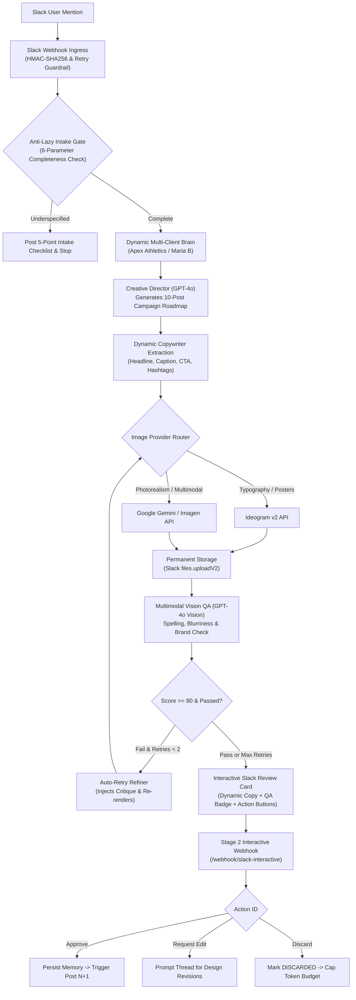

# Enterprise Slack AI Graphic Design Agency (Production Architecture)

An enterprise-grade, multi-agent AI graphic design agency running on a self-hosted **n8n** automation network, integrated with Slack, OpenAI GPT-4o, GPT-4o Vision, Ideogram v2, and Google Gemini.

---

## 🌟 Key Subsystems & Architecture



---

## 📁 Repository Structure
```text
ai-design-agency-n8n/
├── client-brain/
│   ├── apex_athletics_brain.json           # Biomechanical sportswear brand memory
│   ├── maria_b_brain.json                  # Luxury Pakistani fashion memory & product integrity rules
│   ├── channel_client_mapping.json         # Dynamic channel & keyword router
│   └── client-memory-schema.json           # JSON Schema for client persistent memory
├── production-slack-ai-design-agency.json  # CANONICAL Production Workflow (Ingress to Stage 2)
├── n8n-error-handler-workflow.json         # Global Incident Alerting Workflow
├── archive/
│   └── slack-design-agent-workflow.deprecated.json # Archived blind batch prototype
├── docs/
│   └── system-architecture.md              # Detailed technical specification
├── start-n8n.bat                           # Windows batch launcher
├── start-n8n.ps1                           # PowerShell launcher
├── .env.example                            # Production environment variables
└── README.md                               # Project documentation
```

---

## 🚀 Setup & Deployment Guide

### 1. Launch n8n Locally
Double-click `start-n8n.bat` or run:
```powershell
.\start-n8n.ps1
```
Open **`http://localhost:5678`** in your browser.

### 2. Expose Webhook Endpoints via Tunnel
Slack requires HTTPS endpoints:
```powershell
npx ngrok http 5678
# or with cloudflare:
# cloudflared tunnel --url http://localhost:5678
```

Configure your Slack App settings at [api.slack.com/apps](https://api.slack.com/apps):
* **Event Subscriptions Request URL**:  
  `https://<your-tunnel-domain>/webhook/slack-design-agent`  
  *(Subscribed events: `app_mention`, `message.im`)*
* **Interactivity & Shortcuts Request URL**:  
  `https://<your-tunnel-domain>/webhook/slack-interactive`

### 3. Import Workflows into n8n
1. In n8n (`http://localhost:5678`), go to **Workflows** -> **Import from File**.
2. Import **[`production-slack-ai-design-agency.json`](./production-slack-ai-design-agency.json)**.
3. Import **[`n8n-error-handler-workflow.json`](./n8n-error-handler-workflow.json)**.
4. Set up your environment variables or credentials:
   - `SLACK_BOT_TOKEN`
   - `OPENAI_API_KEY`
   - `IDEOGRAM_API_KEY`
   - `GEMINI_API_KEY`
5. Activate both workflows.

---

## 👗 Fashion & Product Accuracy Mode (Maria B)
When requests reference **Maria B** (or any client flagged for garment preservation):
1. **Never Hallucinates Clothes**: The system forbids generative alterations of garments, fabric textures, or embroidery.
2. **Slack Attachment Ingestion**: Takes real product studio photos uploaded in Slack.
3. **Background & Typography Only**: Instructs the rendering engine to generate only regal architectural backdrops, lighting, and typography around the authentic product.
