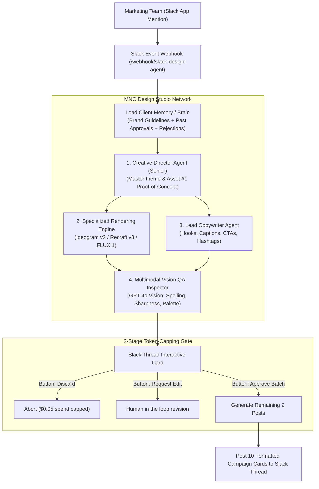

# Enterprise AI Graphic Design Agency & Automation Network

This repository implements an autonomous, multi-agent AI graphic design agency integrated with Slack and orchestrated locally with **n8n**.

## 1. System Architecture

## 2. Multi-Agent Hierarchy

- **Executive Creative Director**: Deconstructs briefs, enforces brand guidelines, and defines multi-post narrative arcs.
- **Art Director & Lead Copywriter**: Establishes composition, lighting, aspect ratios (4:5 / 1:1), and crafts platform-optimized captions.
- **Production Workers**: Formats prompt tokens for specialized graphic engines.
- **Multimodal Vision QA Inspector**: Automatically checks rendered assets character-by-character for spelling errors, blurry text, and brand alignment.

## 3. Unit Economics & Pricing Model

- **Raw API Cost per 10-Post Batch**: ~$0.08 (Budget/Flux) to ~$0.65 (Premium Ideogram v2 + GPT-4o).
- **Aborted Draft Cost**: ~$0.05 (prevents runaway token costs).
- **Agency Value**: Traditional agencies charge $2,500 – $6,000 for a 10-post batch.
- **Enterprise SaaS Retainer**: $1,499 – $3,999/month (>99% Gross Profit Margin).
